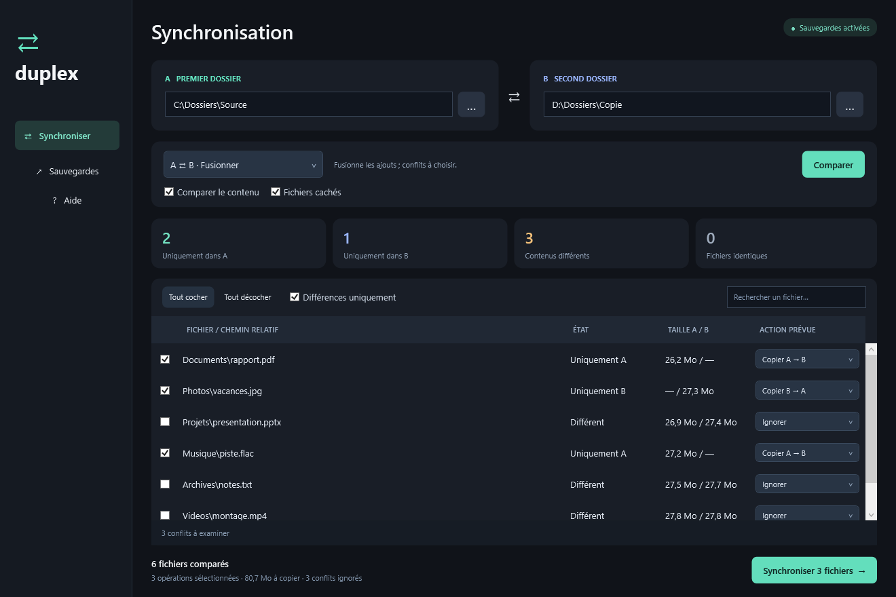

# Duplex

Comparaison et synchronisation de dossiers pour Windows, avec une interface en français.



## Télécharger

La [dernière version](https://github.com/Arieze/Duplex/releases/latest) contient l’exécutable **Duplex.exe**, l’archive portable et les empreintes SHA-256.

Décompressez l’archive et lancez `Duplex.exe`. Windows 10/11 et **.NET Framework 4.8** sont nécessaires. Aucune installation de Duplex n’est requise.

## Fonctionnalités

- Comparaison du contenu par SHA-256 ou comparaison rapide par taille/date.
- Mise à jour A → B ou B → A, fusion et miroir.
- Sélection des fichiers, recherche et choix de la version en cas de conflit.
- Sauvegarde des fichiers remplacés ou retirés par le miroir.
- Vérification des copies, annulation et refus des analyses incomplètes.

La synchronisation est manuelle. Les dossiers vides, jonctions, liens symboliques, droits NTFS et flux alternatifs ne sont pas reproduits. Le mode miroir archive les fichiers retirés dans `.duplex-backups` ; les sauvegardes ne sont jamais purgées automatiquement.

## Documentation

- [Utilisation et restauration des sauvegardes](docs/UTILISATION.md)
- [Compilation, tests et organisation du code](docs/DEVELOPPEMENT.md)
- [Vérification de la version 1.1.0](docs/VALIDATION.md)
- [Historique des versions](CHANGELOG.md)
- [Contribuer](CONTRIBUTING.md)

## Compiler

Dans PowerShell, à la racine du dépôt :

```powershell
.\scripts\build.ps1
.\scripts\test.ps1
.\scripts\package.ps1
```

Le script utilise le compilateur .NET Framework de Windows. Les sorties sont placées dans `dist/`, les résultats de tests dans `test-results/`. Aucun paquet externe n’est téléchargé.

## Signaler un problème

Ouvrez une issue avec la version, le mode utilisé, le message d’erreur et un exemple minimal. Masquez les chemins personnels et ne joignez pas vos fichiers privés.
